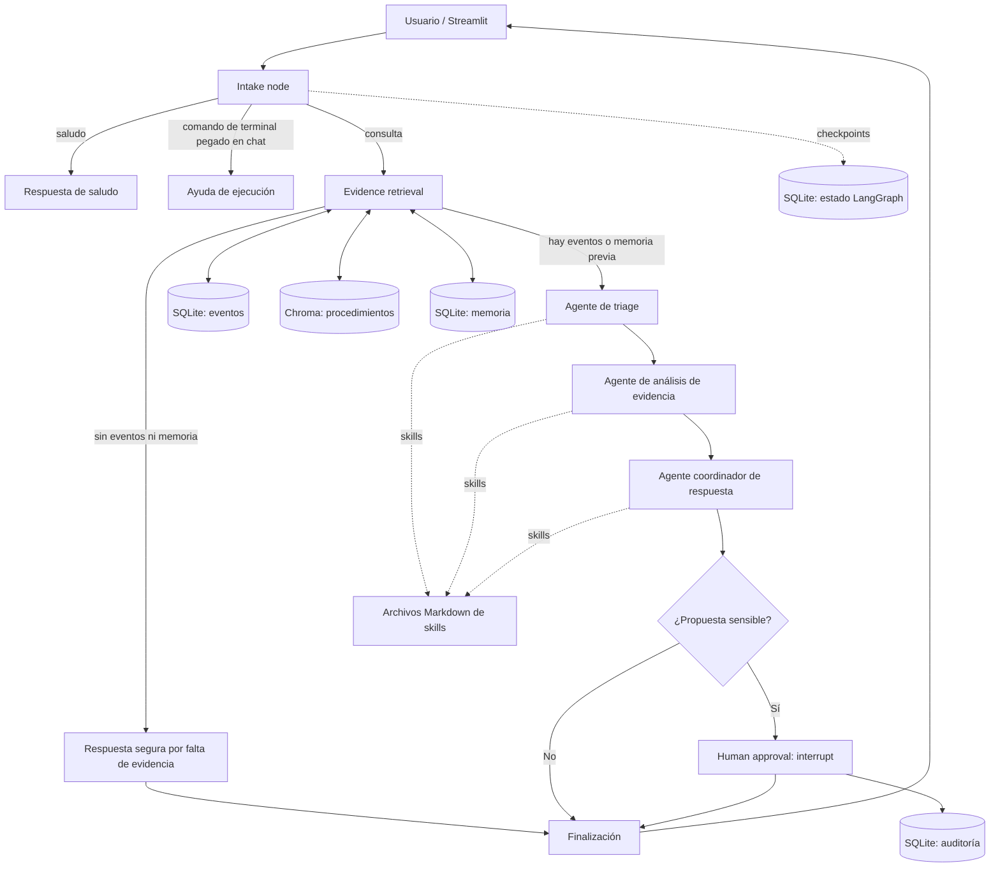

# Arquitectura de SHLD AI

## Responsabilidades y límites

- **Triage:** caracteriza el incidente sin asumir que un indicador aislado confirma compromiso.
- **Análisis:** correlaciona eventos, procedimientos y memoria, indicando fuentes y brechas.
- **Coordinación:** prioriza la investigación y explica la justificación e impacto de las propuestas.
- **Tools:** conectan el flujo con los almacenes de datos. Text-to-SQL se limita a consultas de lectura.
- **Skills:** instrucciones especializadas versionables en archivos separados.
- **Human approval:** una pausa del grafo que requiere una decisión explícita; la decisión se audita, pero no acciona infraestructura.
- **Persistencia:** el historial de ejecución se conserva con el checkpointer; notas y decisiones tienen tablas separadas.
